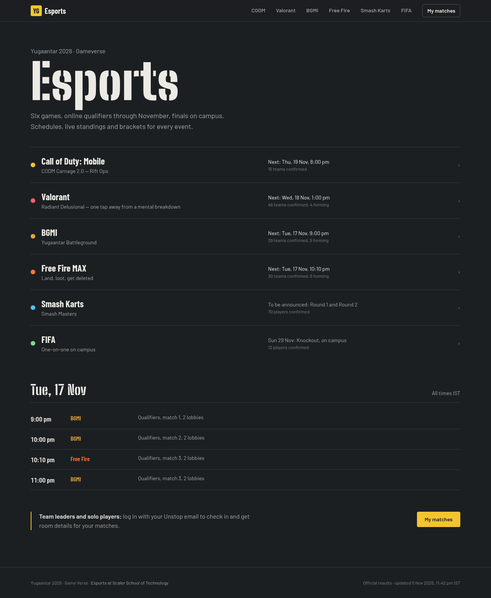
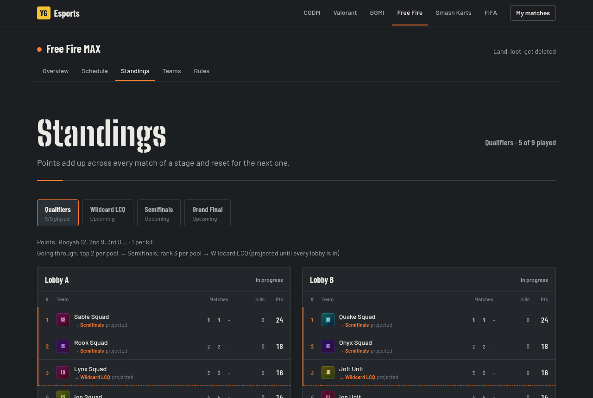
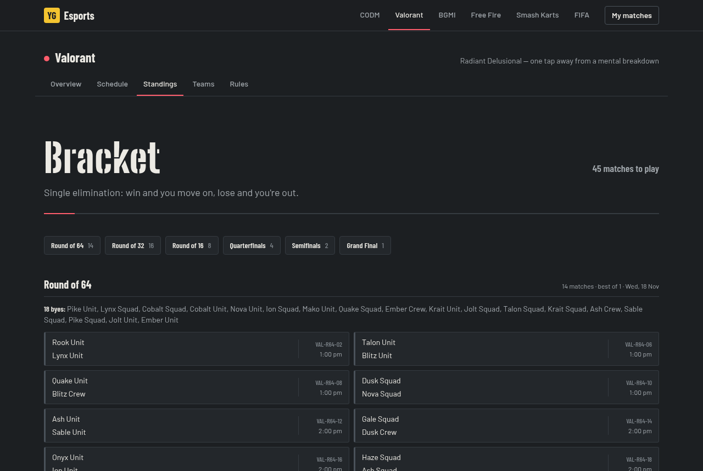
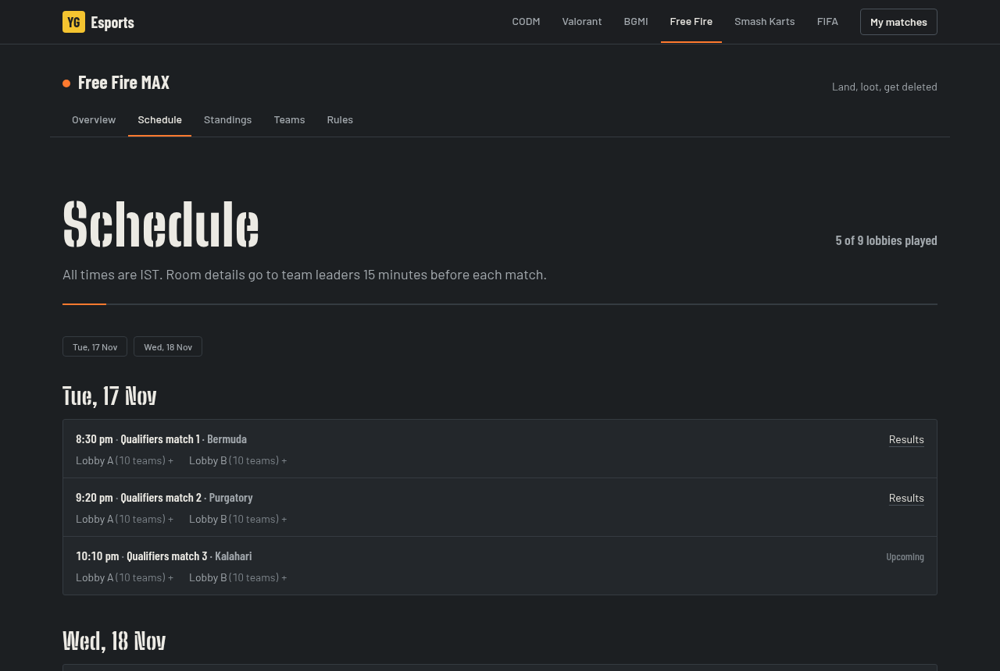
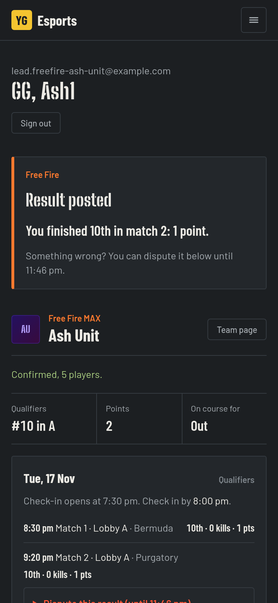
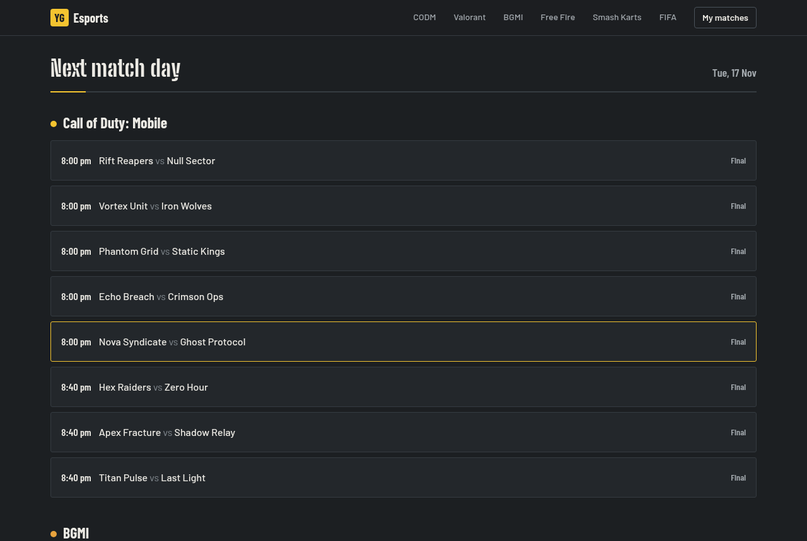
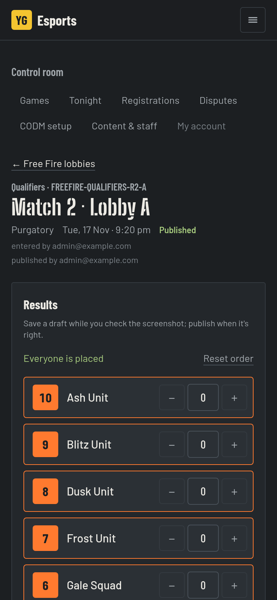
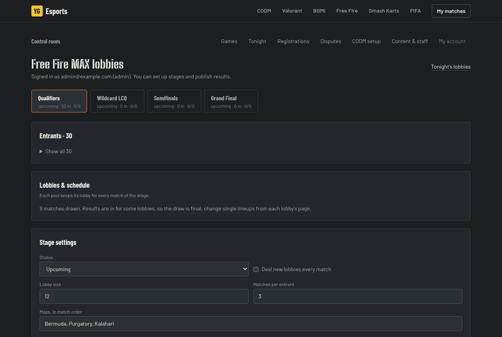
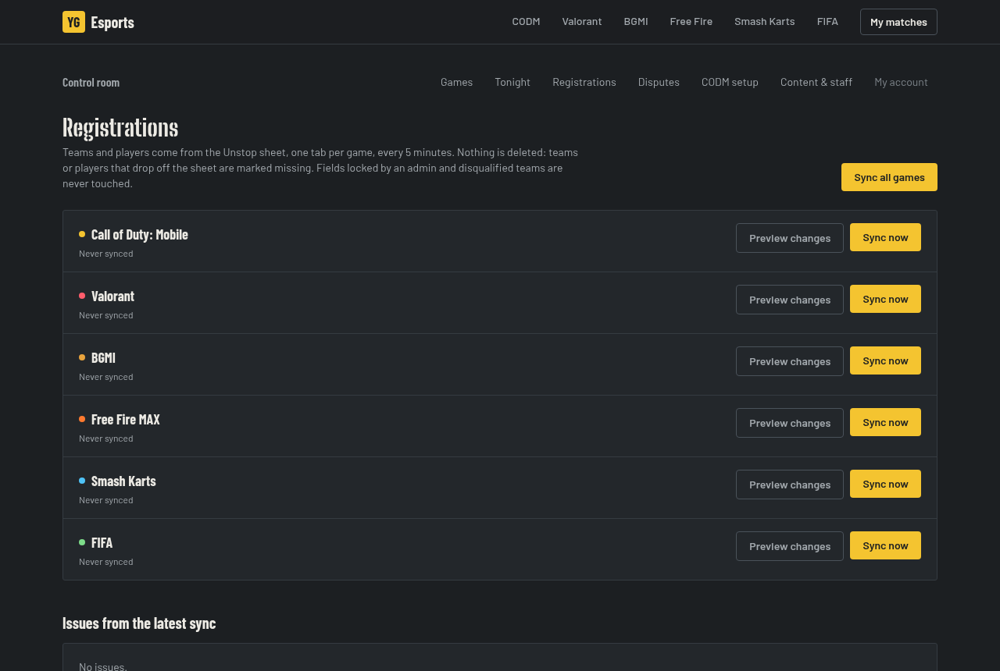

# Yugaantar 2026 Esports

The esports site for **Yugaantar 2026 · Gameverse** at Scaler School of Technology. One site runs all six events:

| Game | Entry | Format |
|---|---|---|
| Call of Duty: Mobile | squads of 5+1 | online BO1 groups, then an offline bracket (CODM Carnage 2.0: Rift Ops) |
| Valorant | teams of 5 | single elimination: BO1 online, Semifinals and Final offline |
| BGMI | squads of 4+1 | battle royale lobbies of up to 20, reshuffled every match, cumulative points |
| Free Fire MAX | squads of 4+1 | battle royale groups of up to 12, top 2 through, 3rd places to a Wildcard LCQ |
| Smash Karts | solo | free-for-all lobbies of 20, reshuffled every match, 20 → 1 points |
| FIFA | solo | knockout on campus |

It covers the whole event in one place:
- **Public pages:** schedules, live leaderboards and brackets for every game.
- **Registration sync:** teams and players come straight from the Unstop sheet.
- **Leader dashboards:** check-in, room details and results for team leaders and solo players.
- **Referee screens:** results are entered from a phone, and every table updates as soon as one is published.



## Contents

- [Branches](#branches)
- [What's on the site](#whats-on-the-site)
- [How data flows](#how-data-flows)
- [Running the event](#running-the-event)
- [Game formats](#game-formats)
- [Try it with Docker](#try-it-with-docker)
- [Local development](#local-development)
- [Tests](#tests)
- [Production setup](#production-setup)
- [Project layout](#project-layout)

## Branches

| Branch | What it is |
|---|---|
| `main` | The full platform: Supabase (Postgres + Auth), every game, logins, referee and admin screens. |
| `Dev` | `main` plus a Docker setup that runs the whole site with a demo tournament. |
| `sheets` | A display-only version. No database and no logins: rosters come from the Unstop sheet and results from a results sheet per game. |
| `backend` | The CODM-only version from before the multi-game rebuild. |

The rule documents for each game are in [`docs/`](docs). The site shows a short version of each, and the PDFs are served from `public/rules/`. `context.md` is the running project log: decisions, open questions for organisers, changelog.

## What's on the site

### Public pages

**Hub (`/`).** Every game with its status and confirmed team count, plus the next match day across all games.

**Game pages (`/<game>`).** Each game has five tabs: Overview, Schedule, Standings, Teams and Rules. The Standings tab adapts to the format:
- **Lobby games:** one leaderboard per lobby, or one overall table when lobbies reshuffle.
  - Qualifying rows are marked with where they're going, e.g. *→ Semifinals* or *→ Wildcard LCQ*, as projected until the stage is complete.
  - Long tables (Smash Karts has ~360 players) show the top 40 and a *Find your team* box.
- **Valorant and FIFA:** the bracket, round by round. Byes are listed on one line.
- **CODM:** group tables, seeding and the offline bracket.





The **Schedule** tab groups lobbies by evening, time and match number. **Teams** lists everyone registered; each team page shows its roster, results per stage and upcoming lobbies.



### Leader dashboard (`/me`)

Only **team leaders and solo players** log in, with the email they registered on Unstop. They get a 6-digit code by email; there's no password and no sign-up. Team members don't need an account, since everything they need is public.

At the top of the page is one **"Do this now"** card. It shows whichever matters most right now:
- check in for tonight;
- the room ID and password, with copy buttons;
- a result that was just posted;
- the countdown to the next match.

Below it there's one section per team the person leads; a person can lead teams in several games. Each section shows:
- eligibility, e.g. *Forming, 3 of 4 players*;
- the team's lobbies or matches, evening by evening;
- one check-in per evening for lobby games;
- published placements, kills and points;
- a dispute button while the window is open.

CODM keeps its own dashboard: veto, substitutions and Veto Power.



### Referee screens

**Tonight (`/ref`)** lists the next match day's lobbies and matches, but only for the games the referee runs.

**Staff (`/admin/staff`)** gives accounts roles by email: `admin`, or game tags such as `codm-ref`, `valo-ref`, `bgmi-ref`, `ff-ref`, `karts-ref` and `fifa-ref` (or all games). Admins run everything. A referee runs their own games end to end (stages, draws, brackets, publishing results, that game's registration sync) and can't touch any other game; the database enforces this too, down to who can read player contact details.

**Your own schedule:** a logged-in team leader sees their team's next matches pinned to the top of that game's Overview and Schedule, and can add them to their phone calendar. The feed (`/calendar/<game>/<team>.ics`) updates as matches are drawn or moved and reminds them when check-in opens.

**Referees on game pages:** every game's Overview lists its referees and organisers. Names are public; WhatsApp, Discord and email only show to that game's team leaders (also on their dashboard) and staff. Staff fill in their own details on the control room home; admins can edit anyone's on the Staff page.



**Lobby result entry** is built for a phone:
1. Tap teams in finishing order, and tap again to undo.
2. Set kills with a stepper.
3. Add point adjustments with a reason (e.g. −2 for hitting the Smash Karts host kart) and paste the screenshot link.
4. *Save draft*, then *Publish*. Publishing needs every placement filled in and unique.

The same page sets the room details, marks the lobby live or cancelled, shows who checked in, edits the lineup and resolves disputes. If two referees save the same lobby, the second is told to reload instead of overwriting.



**Head-to-head matches** (CODM, Valorant, FIFA) use the match page: check-in, room, map scores, and the CODM map veto.

### Admin

**Games (`/admin`)** leads to each game's control room. For lobby games the control room:
- creates the stages from the game's doc;
- fills entrants from eligible teams, or from the previous stage's qualifiers;
- draws lobbies and schedules them, with the doc's times filled in;
- edits points tables, tiebreakers and advancement rules;
- lists every lobby with its result state.

For Valorant and FIFA it draws the bracket, seeded or random. Valorant's online rounds are scheduled from its doc: 4 lobbies, 60-minute slots from 1 PM.



**Registrations (`/admin/sync`)** shows each game's last sync, eligible teams, *Preview changes* and *Sync now*, and the problems to fix on Unstop.



## How data flows

```
Unstop ──► registrations sheet (one tab per game)
              │  every 5 min (Supabase cron → /api/sync) or "Sync now"
              ▼
         teams, players, player_contacts  (eligible = confirmed + full roster + one leader)
              │
 Admin: stages, lobbies, bracket ──► lobby_matches (lineups public) / matches
              │
 Referee: placements + kills (draft) ──► publish ──► lobby_results / maps
              │
 Engines: lobby standings + advancement, h2h standings + seeds + brackets
              │
 Public pages (cached per game; a publish refreshes that game at once) + /me dashboards
```

**The sync** matches teams by name and players by email.
- Nothing is ever deleted: rows that disappear from the sheet are marked missing.
- Withdrawn duplicates that Unstop leaves behind are ignored.
- A renamed team is recognised by its leader's email.
- Fields an admin locked, and disqualified teams, are never touched.
- After a game's roster lock time, changes are listed for an admin instead of applied.

**Security**
- Row Level Security is on for every table. The public reads teams, schedules, lineups and *published* results.
- Contacts, room details, check-ins, disputes and drafts are staff-only in the database.
- Leader actions are checked in server code (own team, leader only, inside the time window) before the service role writes them.
- The login form responds the same way to unknown emails.

## Running the event

### Before the first match

1. Share the registrations sheet with the service account, or keep it public, and check **Registrations** shows every game syncing.
2. Fix what the issues list flags on Unstop: duplicate emails, missing IGNs or game IDs, rosters that are too small.
3. After registration closes:
   - **Lobby games:** open the game's control room → *Create stages* → *Fill from eligible teams* → *Draw lobbies*.
   - **Valorant, FIFA:** *Draw bracket*.
   - **CODM:** Setup → draw groups → generate fixtures → generate bracket.
4. Add referees under Staff and tag each with their games (e.g. `valo-ref`).

### A lobby night (Free Fire, BGMI, Smash Karts)

1. Leaders check in from `/me`, once for the whole evening.
2. The referee opens the lobby from `/ref`, enters the room ID and password, and marks the lobby live. Leaders see the room details from the game's reveal time (15 minutes before for most games).
3. After the match the referee taps in the finishing order and kills, pastes the screenshot link and publishes. An admin publishes instead if referees aren't allowed to.
4. When every lobby of a stage is published, the next stage's *Fill from …* takes the qualifiers, and the LCQ fills the same way.

### A head-to-head match (CODM, Valorant, FIFA)

Check-in, room and scores happen on the match page. Brackets move on their own: sides are references like `W:VAL-R64-01`, and byes are walked over automatically.

## Game formats

Each game's facts live in [`src/games/registry.ts`](src/games/registry.ts): roster size, sheet tab, check-in and room times, prizes, key dates, rules summary and the stages for lobby games. Points tables, tiebreakers and advancement rules can be changed per stage in the admin panel.

| | Lobby | Points | Tiebreakers | Advancement |
|---|---|---|---|---|
| **Free Fire MAX** | 12, fixed groups | Booyah 12, 9, 8, 7, 6, 5, 4, 3, 2, 1 + 1 per kill | Booyahs, kills, latest match | Qualifiers: top 2 per group → Semifinals, 3rd → Wildcard LCQ (top 6 through); Semifinals: top 6 per lobby → Grand Final |
| **BGMI** | 20, reshuffled | 10, 6, 5, 4, 3, 2, 1, 1, 1, 1 + 1 per kill | chicken dinners, placement points, finishes, latest match | top 32 → Semifinals → top 16 → Final |
| **Smash Karts** | 20 + host kart, reshuffled | 20 → 1 by rank | kills, best rank | top 120 → top 40 → top 20 |

The Free Fire docs disagree on some points. The defaults follow the latest one, the 17–23 Nov operations plan; the 84/104-team rulebooks use 8-7-6… instead. See *Open questions* in `context.md`.

**CODM** is unchanged:
- groups by registration count, one mode per evening (8–10 PM, 3 slots × 5 lobbies);
- wins → head-to-head → tiebreaker match → coin toss;
- seeds 1–8 into an offline bracket on 27–29 Nov.

The details are on `/codm/rules`.

## Try it with Docker

On the `Dev` branch, one command runs the site with its own database, logins and a demo tournament (invented teams, Free Fire and BGMI qualifiers part-played, the Valorant bracket drawn):

```sh
docker compose up --build
```

- Site: http://localhost:3000. The first start builds the site, about a minute.
- Login codes: http://localhost:8025 (a mail catcher; nothing is really sent).
- Logins: `admin@example.com` (everything), `valo.ref@example.com` (Valorant referee), `lead.freefire-ash-squad@example.com` (a Free Fire team leader).
- Other ports: `ESPORTS_PORT=3400 MAIL_PORT=8026 docker compose up --build`.
- Start over: `docker compose down -v` wipes the database; the next start loads the demo again.

It runs Postgres, Supabase's auth and API services, a small gateway and a mail catcher next to the app (`compose.yaml`, `docker/`). Registration sync is switched off there, so the real Unstop sheet never mixes into the demo. The keys in `compose.yaml` are Supabase's public demo keys: fine for this, never for production.

To ship your own local state as the demo, run `docker/db/export-demo.sh` while `supabase start` is running. It refuses if the database holds real contact details.

## Local development

Needs Node 22.18+ (scripts and tests run TypeScript directly) and Docker.

```bash
npm install
npx supabase start          # local Postgres + Auth + Mailpit
npx supabase status         # copy the API URL and keys into .env.local (see .env.example)
npm run db:reset            # rebuild supabase/seed.sql and reload the database
npm run dev                 # http://localhost:3000
```

The seed has the CODM sample tournament plus invented registrations for every other game, some of them still forming. Login emails land in Mailpit at http://127.0.0.1:54324.

| Email | Role |
|---|---|
| admin@example.com | admin |
| ref@example.com | referee, every game |
| ff.ref@example.com | referee, Free Fire only |
| rr.viper@example.com | CODM captain (Rift Reapers) |
| `lead.<team-id>@example.com` | leader of any other seeded team, e.g. lead.freefire-ash-unit@example.com |

To try the sync locally, set `SYNC_SECRET` in `.env.local` and call `curl -H "Authorization: Bearer $SYNC_SECRET" "localhost:3000/api/sync?dry=1"`. Leave out `dry=1` to write.

## Tests

```bash
npm test          # engines, sync parsing, rule timings
npm run typecheck
npm run lint
```

The tests cover:
- **Lobby engine:** points, every tiebreaker, advancement rules (including the Free Fire LCQ) and pool-scoped ties.
- **Lobby dealing:** reshuffles that avoid repeat opponents, scheduling, and checks on entered results.
- **Brackets:** any size up to 128, with byes spread out and walked over.
- **Sync parsing:** run against the real header rows of the Unstop sheet, with invented people.
- **CODM:** standings, seeds, scheduler, veto and late-penalty timings.

## Production setup

1. **Supabase:** create a project in Mumbai (ap-south-1), then run `npx supabase link --project-ref <ref>` and `npx supabase db push`.
2. **First admin:** in the SQL editor, run `insert into staff (email, role) values ('you@college.edu', 'admin');`. Add everyone else from Admin → Content & staff.
3. **Auth → URL Configuration:** set the Site URL to `https://<your-domain>`, and add `https://<your-domain>/auth/confirm` to Redirect URLs.
4. **Auth → SMTP (required):** the built-in mailer only reaches your own Supabase organisation.
   - Brevo (300 a day free), Amazon SES or a Gmail app password all work.
   - Leaders log in about once for the whole event, so a few hundred emails cover it.
5. **Auth → Email Templates:** paste `supabase/templates/login.html` into *Magic Link* and *Confirm signup*. Use the subject "Your Yugaantar Esports login code".
6. **Auth → Rate Limits:** raise the email limit, and raise sign-ins per IP to about 150 per 5 minutes (a venue shares one Wi-Fi IP).
7. **Vercel:** import the repo and set the environment variables from `.env.example`:
   - `NEXT_PUBLIC_SUPABASE_URL`, `NEXT_PUBLIC_SUPABASE_ANON_KEY`, `SUPABASE_SERVICE_ROLE_KEY`, `NEXT_PUBLIC_SITE_URL`;
   - `SYNC_SECRET`;
   - `GOOGLE_SERVICE_ACCOUNT_JSON`, if the sheet is private;
   - `REGISTRATION_SHEET_ID`, if it isn't the default sheet.
8. **Sync every 5 minutes:** run [`supabase/snippets/sync-cron.sql`](supabase/snippets/sync-cron.sql) once in the SQL editor, with your site URL and secret.
9. **Free plan:** projects pause after 7 days without traffic, which the sync job prevents.

Public pages are cached per game and refreshed whenever a result is published, so match-night traffic barely touches the database.

## Project layout

```
src/
  app/
    page.tsx                 event hub
    [game]/                  game pages: overview, schedule, standings, teams, rules
    me/                      leader dashboard and leader actions
    ref/                     referee home: tonight's lobbies and matches
    admin/                   games, per-game control rooms, lobby result entry, sync, CODM setup
    api/sync/                registration sync endpoint (cron)
  games/registry.ts          every game's facts and lobby stage defaults
  lib/
    lobby/                   lobby engine: standings, tiebreakers, advancement, dealing; data loader
    sync/                    Unstop sheet: fetch, parse, apply
    knockout.ts              single-elimination brackets with byes
    tournament.ts            head-to-head engine: series, groups, seeds, slot references
    data.ts                  cached reads for public pages
  views/                     page bodies shared by the game routes (CODM, lobby, knockout)
  components/                MatchCard, StandingsTable, KnockoutBracket, …
supabase/
  migrations/                schema and Row Level Security
  snippets/sync-cron.sql     scheduled sync
  seed.sql                   generated local data (npm run seed-sql)
docs/                        organisers' rule documents, screenshots
```
